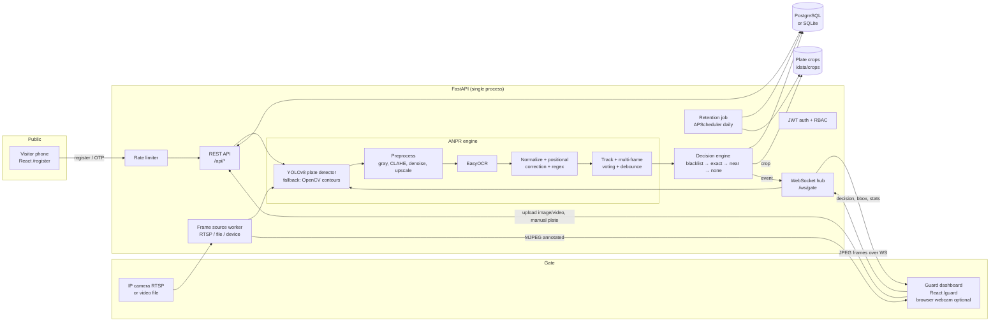
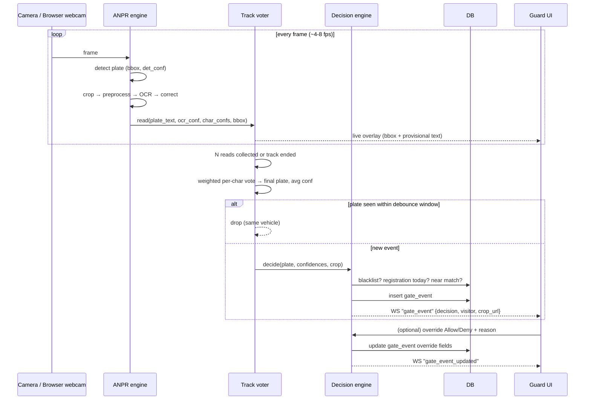
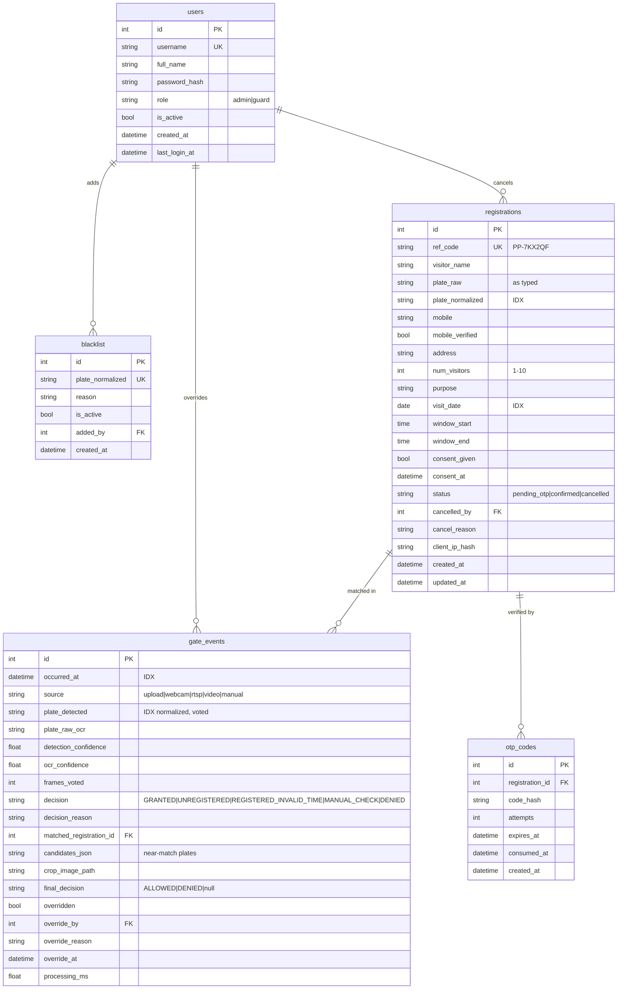

# PlatePass — Phase 1: Architecture, Folder Structure, DB Schema, API

> Working name: **PlatePass** (suggested replacement for "GateSense"). Alternatives: *GateWise*, *PassPlate*, *Drive-Thru Pass*.
> Everything below uses `platepass` as the package name; renaming is one search-and-replace.

---

## 0. Assumptions

1. **Single gate, single backend instance.** The camera worker, multi-frame voter and WebSocket broadcaster all live in one FastAPI process (`uvicorn --workers 1`). Enough for one gate; multi-gate scaling is listed as a limitation.
2. **Time zone** is `Asia/Kolkata` (configurable via `APP_TIMEZONE`). "Today" and arrival windows are evaluated in that zone; timestamps are stored in UTC.
3. **Plate formats supported:** standard Indian private/commercial plates and BH-series. Diplomatic, temporary (`T...`), army (arrow) and very old formats are out of scope.
   - Standard: `^[A-Z]{2}[0-9]{1,2}[A-Z]{0,3}[0-9]{4}$` (e.g. `TN37AB1234`, `DL3CAB1234`, `KA011234`)
   - BH: `^[0-9]{2}BH[0-9]{4}[A-Z]{1,2}$` (e.g. `22BH1234AA`)
4. **Arrival window:** visitor picks a start/end time on the visit date. A configurable grace period (`ARRIVAL_GRACE_MINUTES`, default 60) applies on both sides. `ENFORCE_TIME_WINDOW=true` by default; if false, only the date is checked.
5. **One registration per vehicle per date** — enforced by a unique constraint on `(plate_normalized, visit_date)` over non-cancelled rows.
6. **OTP is mocked:** a 6-digit code is printed in server logs (and returned in the API response when `OTP_DEMO_ECHO=true`, handy on stage). Registration works without OTP when `OTP_REQUIRED=false`.
7. **Plate detector weights:** Ultralytics does not ship a licence-plate model. We use an open community YOLOv8 licence-plate checkpoint (downloaded once at Docker build into `backend/models/plate_yolov8n.pt`, path configurable via `PLATE_MODEL_PATH`). If the weights are missing or fail to load, the pipeline **falls back to an OpenCV contour/morphology plate detector** so the demo never dies.
8. **OCR engine:** EasyOCR (English, CPU by default, `USE_GPU=auto`). PaddleOCR was rejected: heavier install, frequent wheel/version breakage on CPU-only laptops, marginal gain for single-line plates.
9. **Roles:** `admin` (everything) and `guard` (dashboard, overrides, manual entry, read today's data). Public visitors are unauthenticated.

---

## 1. Spec changes I recommend (and what I'll build instead)

| # | Spec item | Problem | What I'll build |
|---|-----------|---------|-----------------|
| 1 | "Live webcam" read by the backend container | Docker on macOS/Windows **cannot access the laptop webcam** (`/dev/video0` passthrough only works on Linux). The live demo would fail on most judges' laptops. | Two live modes: **(a) Browser webcam** — the dashboard captures frames with `getUserMedia` and pushes JPEGs over the WebSocket (~4 fps); works everywhere. **(b) Server-side source** — RTSP URL, local video file, or `/dev/video0` (Linux), read by the backend worker via OpenCV. |
| 2 | Edit-distance-1 near match | Two plates that differ by one character are often **genuinely different vehicles**. | Implemented exactly as you said: near match → `MANUAL_CHECK`, never auto-grant. Also: a near match to a **blacklisted** plate is flagged prominently in the manual check. |
| 3 | Debounce "same plate in consecutive frames" | OCR jitter means consecutive frames produce *slightly different* strings (`TN37AB1234` / `TN37A81234`), defeating naive debouncing. | A **track-based voter**: reads are grouped into a "vehicle track" while a plate stays in view (by IoU of bounding boxes + string similarity). Per-character confidence-weighted voting over N frames (default 5, or track end) produces one plate; the debounce key is the *voted* plate. |
| 4 | Store address | Address isn't needed at the gate; it's the most sensitive field. | Stored (as required) but **only visible to admins**; guard UI shows name, masked mobile, visitor count, purpose. Registrations are auto-purged `REGISTRATION_RETENTION_DAYS` (default 30) after the visit date, alongside the image purge. |
| 5 | QR code on confirmation | Fine as reference, but tempting to make it an auth token. | QR encodes only the registration reference code (`PP-7KX2QF`). Not used for access control (the plate is). Guard can type the code into the manual box to look it up. |
| 6 | PostgreSQL + SQLite fallback with Alembic | SQLite can't `ALTER` columns. | Alembic configured with `render_as_batch=True`, and no Postgres-only column types, so the **same migrations** run on both. |
| 7 | Rate limiting | Need something that works without Redis. | `slowapi` in-memory limiter (e.g. 10 registrations/min/IP, 5 OTP sends/10 min/mobile). Fine for one instance. |

If you disagree with any of these, tell me before Phase 2.

---

## 2. Architecture



### Request/decision sequence (camera event)



### Decision engine (order matters)

```
input: plate P (normalized), ocr_conf, det_conf, now

1. P on active blacklist (exact)                       → DENIED
2. ocr_conf < OCR_MIN_CONFIDENCE (0.60)
   or P fails plate regex                              → MANUAL_CHECK (reason=low_confidence|invalid_format)
3. confirmed registration with plate=P, date=today:
     within [start - grace, end + grace]
       or ENFORCE_TIME_WINDOW=false                    → GRANTED
     else                                              → REGISTERED_INVALID_TIME (reason=outside_window)
4. registration with plate=P on another date
   (nearest upcoming/past within 30 days)              → REGISTERED_INVALID_TIME (reason=wrong_date)
5. any today's registration or blacklist entry
   with Levenshtein(P, plate) == 1                     → MANUAL_CHECK (reason=near_match, candidates=[...])
6. otherwise                                           → UNREGISTERED
```

`MANUAL_CHECK` and `REGISTERED_INVALID_TIME` stay "pending" on the guard screen until the guard clicks Allow/Deny (reason mandatory). `GRANTED`/`UNREGISTERED`/`DENIED` can also be overridden, again with a mandatory reason. The original decision is never overwritten — override fields are separate.

### Key design points
- **Latency budget (CPU laptop):** YOLOv8n @640 ≈ 60–120 ms, EasyOCR on a small crop ≈ 100–250 ms → ~350 ms/frame. With 5-frame voting at ~4 fps the decision lands in ~1.3–1.8 s. For single uploaded images the decision is immediate (1 read). Models load once at startup (warm-up inference) to avoid a slow first event.
- **Concurrency:** inference runs in a single dedicated worker thread fed by a size-1 "latest frame" queue (old frames are dropped, never queued up), so the API stays responsive and the system never lags behind real time.
- **Images:** only the plate **crop** is persisted (not full frames — privacy), at `/data/crops/YYYY/MM/DD/<event_id>.jpg`, served through an auth-protected endpoint.
- **Realtime:** one WebSocket `/ws/gate?token=<jwt>` carries both directions: server→client (`gate_event`, `gate_event_updated`, `live_detection`, `stats`) and client→server (`frame` JPEG for browser-webcam mode).
- **Annotated live view:** for server-side sources the backend serves `GET /api/stream/mjpeg` with bounding boxes drawn. For browser webcam, the browser draws the box from `live_detection` messages on a canvas overlay.

---

## 3. Folder structure

```
platepass/
├── README.md
├── DEMO.md                         # 3-minute judge script
├── docker-compose.yml
├── .env.example
├── .gitignore
├── docs/
│   └── ARCHITECTURE.md             # this file
├── samples/
│   ├── images/                     # sample plate photos (+ generator script output)
│   ├── videos/                     # demo_gate.mp4 (generated)
│   └── make_samples.py             # renders synthetic Indian plates → images/video
│
├── backend/
│   ├── Dockerfile
│   ├── pyproject.toml              # deps + ruff/mypy/pytest config
│   ├── requirements.txt            # pinned runtime deps
│   ├── requirements-ml.txt         # torch(cpu)/ultralytics/easyocr (separate layer)
│   ├── alembic.ini
│   ├── alembic/
│   │   ├── env.py
│   │   ├── script.py.mako
│   │   └── versions/
│   │       └── 0001_initial_schema.py
│   ├── scripts/
│   │   ├── seed.py                 # admin, guard, sample registrations, blacklist
│   │   ├── download_models.py      # fetch YOLO plate weights + EasyOCR models
│   │   └── entrypoint.sh           # wait-for-db → alembic upgrade → seed (opt) → uvicorn
│   ├── models/                     # downloaded weights (gitignored)
│   ├── app/
│   │   ├── __init__.py
│   │   ├── main.py                 # app factory, lifespan (load ANPR, start workers)
│   │   ├── config.py               # pydantic-settings
│   │   ├── logging_config.py
│   │   ├── db.py                   # engine, SessionLocal, Base
│   │   ├── deps.py                 # get_db, current_user, require_role
│   │   ├── security.py             # bcrypt hashing, JWT encode/decode
│   │   ├── rate_limit.py           # slowapi limiter
│   │   ├── models/
│   │   │   ├── __init__.py
│   │   │   ├── user.py
│   │   │   ├── registration.py
│   │   │   ├── otp.py
│   │   │   ├── gate_event.py
│   │   │   └── blacklist.py
│   │   ├── schemas/
│   │   │   ├── __init__.py
│   │   │   ├── auth.py
│   │   │   ├── registration.py
│   │   │   ├── gate.py
│   │   │   ├── blacklist.py
│   │   │   └── common.py
│   │   ├── core/                   # pure, framework-free logic (heavily unit-tested)
│   │   │   ├── __init__.py
│   │   │   ├── plates.py           # normalize, regex validate, positional OCR correction
│   │   │   ├── matching.py         # decision engine (pure function over candidates)
│   │   │   ├── levenshtein.py
│   │   │   ├── masking.py          # XXXXXX1234
│   │   │   └── refcode.py          # PP-XXXXXX reference codes
│   │   ├── services/
│   │   │   ├── __init__.py
│   │   │   ├── registration_service.py
│   │   │   ├── otp_service.py
│   │   │   ├── gate_service.py     # plate → decision → persist → broadcast
│   │   │   ├── stats_service.py
│   │   │   ├── export_service.py   # CSV streaming
│   │   │   └── retention_service.py
│   │   ├── realtime/
│   │   │   ├── __init__.py
│   │   │   └── hub.py              # WebSocket connection manager / broadcaster
│   │   ├── anpr/
│   │   │   ├── __init__.py
│   │   │   ├── types.py            # PlateRead, Detection, VotedPlate dataclasses
│   │   │   ├── detector.py         # YoloPlateDetector + ContourPlateDetector
│   │   │   ├── preprocess.py
│   │   │   ├── ocr.py              # EasyOCR wrapper (allowlist, per-char conf)
│   │   │   ├── pipeline.py         # frame → [PlateRead]
│   │   │   ├── voting.py           # tracks, char voting, debounce
│   │   │   ├── sources.py          # RTSP / file / device frame sources
│   │   │   ├── worker.py           # inference thread, latest-frame queue
│   │   │   └── annotate.py         # draw bbox/text for MJPEG
│   │   └── api/
│   │       ├── __init__.py
│   │       ├── router.py
│   │       ├── auth.py
│   │       ├── public.py           # registration + OTP
│   │       ├── gate.py             # upload, manual, override, events, stats, sources
│   │       ├── stream.py           # MJPEG + WebSocket
│   │       ├── admin.py            # registrations, logs, CSV, blacklist, users
│   │       └── health.py
│   └── tests/
│       ├── conftest.py             # SQLite in-memory, fixtures, fake ANPR
│       ├── test_plates.py          # normalization + positional correction + regex
│       ├── test_matching.py        # every decision branch
│       ├── test_voting.py          # multi-frame voting + debounce
│       ├── test_registration_api.py# validation, duplicates, OTP, rate limit
│       ├── test_gate_api.py        # manual entry, override reason mandatory
│       ├── test_auth.py
│       └── test_pipeline_samples.py# runs real pipeline on samples/ (skipped if no models)
│
└── frontend/
    ├── Dockerfile                  # node build → nginx
    ├── nginx.conf                  # SPA + /api and /ws proxy to backend
    ├── package.json
    ├── vite.config.ts
    ├── tailwind.config.js
    ├── postcss.config.js
    ├── tsconfig.json
    ├── index.html
    └── src/
        ├── main.tsx
        ├── App.tsx                 # routes
        ├── index.css
        ├── lib/
        │   ├── api.ts              # fetch wrapper + JWT
        │   ├── auth.tsx            # AuthContext
        │   ├── plate.ts            # client-side normalize/validate (mirrors backend)
        │   ├── ws.ts               # reconnecting WebSocket hook
        │   └── types.ts
        ├── components/
        │   ├── Layout.tsx
        │   ├── ProtectedRoute.tsx
        │   ├── ResultCard.tsx      # giant green/red/amber card
        │   ├── LiveFeed.tsx        # MJPEG or browser webcam + canvas overlay
        │   ├── EventFeed.tsx
        │   ├── StatsBar.tsx
        │   ├── OverrideDialog.tsx
        │   ├── ManualEntry.tsx
        │   ├── UploadPanel.tsx     # image / video upload
        │   └── DataTable.tsx
        └── pages/
            ├── Home.tsx
            ├── Register.tsx
            ├── Confirmation.tsx    # ref code + QR
            ├── Login.tsx
            ├── GuardDashboard.tsx
            ├── AdminRegistrations.tsx
            ├── AdminLogs.tsx
            └── AdminBlacklist.tsx
```

Why `core/` is separate from `services/`: plate maths and the decision table are pure functions with zero DB/ML imports, so the required unit tests run in milliseconds and without downloading any model.

---

## 4. Database schema

All tables have `id` (integer PK) and `created_at` (UTC). `updated_at` where rows mutate. Enums are stored as `VARCHAR` + `CHECK` constraints (portable across Postgres/SQLite).



### Constraints and indexes

| Table | Constraint / Index | Purpose |
|-------|--------------------|---------|
| registrations | `ix_reg_plate_date (plate_normalized, visit_date)` | the hot lookup at the gate |
| registrations | `ix_reg_visit_date (visit_date)` | today's list, stats, purge |
| registrations | **partial unique** `uq_reg_plate_date_active (plate_normalized, visit_date) WHERE status <> 'cancelled'` | "same vehicle not twice on the same date", but allows re-registering after cancellation. Partial indexes are supported by both Postgres and SQLite. |
| registrations | `uq ref_code` | confirmation lookup |
| registrations | `CHECK num_visitors BETWEEN 1 AND 10`, `CHECK window_end > window_start`, `CHECK status IN (...)` | defence in depth behind Pydantic |
| gate_events | `ix_ge_occurred_at`, `ix_ge_plate`, `ix_ge_decision` | log filtering, stats, debounce lookups |
| gate_events | `CHECK decision IN (...)`, `CHECK (overridden = false OR override_reason IS NOT NULL)` | override must carry a reason |
| blacklist | `uq plate_normalized` | one entry per vehicle |
| users | `uq username`, `CHECK role IN ('admin','guard')` | |

**Final decision semantics:** what the gate actually did = `final_decision` if overridden, else derived from `decision` (`GRANTED → ALLOWED`, `DENIED/UNREGISTERED → DENIED`, others → pending until guard acts).

**Retention:** a daily APScheduler job (also runnable via `POST /api/admin/maintenance/purge`)
- deletes crop files and nulls `crop_image_path` for events older than `EVENT_IMAGE_RETENTION_DAYS` (default 7);
- hard-deletes registrations whose `visit_date` is older than `REGISTRATION_RETENTION_DAYS` (default 30) — gate events keep the plate and decision but `matched_registration_id` is set NULL (`ON DELETE SET NULL`).

**Migration:** a single hand-reviewed Alembic revision `0001_initial_schema` creates everything above; `alembic upgrade head` runs automatically in the container entrypoint.

---

## 5. API endpoint list

Base path `/api`. Auth column: **—** public, **G** guard or admin, **A** admin only. Interactive docs at `/docs` (Swagger) and `/redoc`.

### Health & auth
| Method | Path | Auth | Description |
|---|---|---|---|
| GET | `/api/health` | — | liveness + DB + ANPR model status (yolo/contour fallback, ocr ready, device) |
| POST | `/api/auth/login` | — | `{username,password}` → `{access_token, role, expires_in}` (rate-limited) |
| GET | `/api/auth/me` | G | current user |

### Public registration
| Method | Path | Auth | Description |
|---|---|---|---|
| POST | `/api/public/registrations` | — (10/min/IP) | create registration; validates plate/mobile/visitors/date/window/consent; 409 on same plate+date; returns `ref_code`, `status`, `otp_required` |
| POST | `/api/public/registrations/{ref_code}/otp/send` | — (5/10 min) | (re)send mock OTP — printed to logs |
| POST | `/api/public/registrations/{ref_code}/otp/verify` | — (attempt-limited) | `{code}` → status `confirmed` |
| GET | `/api/public/registrations/{ref_code}` | — | minimal confirmation view (name initials, masked plate/mobile, date/window, status) |
| GET | `/api/public/registrations/{ref_code}/qr.png` | — | QR image of the ref code |
| GET | `/api/public/meta` | — | form config (max visitors, purposes list, OTP required?, today's date in campus TZ) |

### Gate (guard)
| Method | Path | Auth | Description |
|---|---|---|---|
| POST | `/api/gate/recognize/image` | G | multipart image → full pipeline → decision event (+ plate, det/ocr conf, bbox, crop URL) |
| POST | `/api/gate/recognize/video` | G | multipart video → processed by the worker as a source; events stream over WS |
| POST | `/api/gate/manual` | G | `{plate}` or `{ref_code}` → decision event (source=manual, conf=1.0) |
| POST | `/api/gate/events/{id}/override` | G | `{action: "ALLOW"\|"DENY", reason (min 5 chars)}` |
| GET | `/api/gate/events` | G | recent events (paginated; filters: decision, plate, from, to) |
| GET | `/api/gate/events/{id}` | G | event detail incl. candidates and visitor (masked mobile) |
| GET | `/api/gate/events/{id}/crop.jpg` | G | plate crop image |
| GET | `/api/gate/stats/today` | G | counts: granted, unregistered, manual checks, invalid time, denied, overrides, expected arrivals |
| GET | `/api/gate/source` | G | current server-side source status (type, running, fps) |
| POST | `/api/gate/source` | G | start/stop server source: `{type: "rtsp"\|"video"\|"device"\|"none", uri?}` (defaults from env) |
| GET | `/api/stream/mjpeg` | G (token query) | annotated live MJPEG of the server-side source |
| WS | `/ws/gate?token=` | G | server→client: `gate_event`, `gate_event_updated`, `live_detection`, `stats`, `source_status`; client→server: `frame` (base64 JPEG, browser webcam mode), `ping` |

### Admin
| Method | Path | Auth | Description |
|---|---|---|---|
| GET | `/api/admin/registrations` | A | search (name/plate/mobile/ref), filter (date range, status), paginate, sort |
| GET | `/api/admin/registrations/export.csv` | A | same filters, streamed CSV |
| GET | `/api/admin/registrations/{id}` | A | full detail (unmasked) |
| POST | `/api/admin/registrations/{id}/cancel` | A | `{reason}` → status `cancelled` |
| DELETE | `/api/admin/registrations/{id}` | A | hard delete (privacy request) |
| GET | `/api/admin/gate-events` | A | logs with filters (decision, plate, source, overridden, date range) |
| GET | `/api/admin/gate-events/export.csv` | A | streamed CSV |
| GET | `/api/admin/blacklist` | A | list |
| POST | `/api/admin/blacklist` | A | `{plate, reason}` (plate normalized + validated) |
| PATCH | `/api/admin/blacklist/{id}` | A | toggle active / edit reason |
| DELETE | `/api/admin/blacklist/{id}` | A | remove |
| GET | `/api/admin/users` | A | list users |
| POST | `/api/admin/users` | A | create guard/admin |
| PATCH | `/api/admin/users/{id}` | A | activate/deactivate, reset password, role |
| POST | `/api/admin/maintenance/purge` | A | run retention job now; returns counts |

### Error format
All errors: `{"detail": "...", "code": "DUPLICATE_REGISTRATION" | "VALIDATION_ERROR" | ..., "fields": {...}}` with appropriate HTTP status (400/401/403/404/409/422/429).

---

## 6. Plate post-processing rules (preview of Phase 3)

1. **Normalize:** uppercase, drop everything outside `[A-Z0-9]`; strip a leading `IND` (common on HSRP plates where OCR reads the hologram text).
2. **Positional correction (templates).** For each candidate template the string is coerced char-by-char:
   - digit slot: `O→0, Q→0, D→0, I→1, L→1, T→1, Z→2, J→3, A→4, S→5, G→6, B→8`
   - letter slot: `0→O, 1→I, 2→Z, 3→J, 4→A, 5→S, 6→G, 8→B`
   - Templates: `LL D LLL DDDD` with RTO 1–2 digits and series 0–3 letters, and BH `DD BH DDDD L(L)`.
   - The template whose coerced string matches the regex with the **fewest substitutions**, weighted by low per-char confidence at the substituted positions, wins. State code is further checked against the list of valid Indian state/UT codes (`TN, KA, MH, DL, ...`), a strong prior that fixes `TH→TN`-style misreads only when the substitution is a known confusion pair.
3. **Validate** against the regexes in §0; invalid → `MANUAL_CHECK (invalid_format)` rather than discarded, so the guard still sees the crop.

---

## 7. Configuration (`.env.example` preview)

```
DATABASE_URL=postgresql+psycopg://platepass:platepass@db:5432/platepass   # or sqlite:///./data/platepass.db
JWT_SECRET=change-me
JWT_EXPIRE_MINUTES=720
CORS_ORIGINS=http://localhost:5173,http://localhost:8080
APP_TIMEZONE=Asia/Kolkata
ARRIVAL_GRACE_MINUTES=60
ENFORCE_TIME_WINDOW=true
OTP_REQUIRED=false
OTP_DEMO_ECHO=true
OCR_MIN_CONFIDENCE=0.60
DET_MIN_CONFIDENCE=0.35
VOTE_FRAMES=5
DEBOUNCE_SECONDS=10
CAMERA_SOURCE=none            # none | rtsp | video | device
RTSP_URL=
VIDEO_PATH=/samples/videos/demo_gate.mp4
CAMERA_DEVICE_INDEX=0
PLATE_MODEL_PATH=models/plate_yolov8n.pt
USE_GPU=auto
EVENT_IMAGE_RETENTION_DAYS=7
REGISTRATION_RETENTION_DAYS=30
REGISTRATION_RATE_LIMIT=10/minute
SEED_ON_START=true
```

---

## 8. Phase plan

- **Phase 2 — Backend:** config, DB, models, Alembic migration, auth/JWT/RBAC, registration + OTP, decision engine, gate endpoints (manual/override/events/stats), admin endpoints, CSV export, blacklist, retention job, WebSocket hub, pytest suite. ANPR endpoints wired to an interface with a stub so Phase 2 runs standalone.
- **Phase 3 — ANPR:** detector (YOLO + contour fallback), preprocessing, EasyOCR wrapper, positional correction, track voter + debounce, frame sources, inference worker, MJPEG annotator, sample generator, pipeline tests.
- **Phase 4 — Frontend:** registration + confirmation/QR, login, guard dashboard (live feed, result card, event feed, manual entry, override, stats, uploads), admin pages.
- **Phase 5 — Ops & docs:** Dockerfiles, docker-compose, entrypoint, seed script, README (Mermaid, ≤5-command setup, API summary, limitations), DEMO.md 3-minute script.
